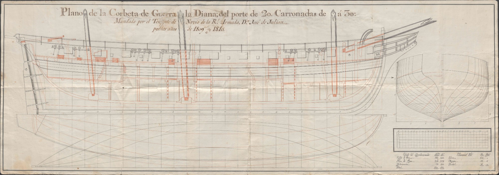

# Decisions: package 90, the Spanish and Mediterranean ships (the owner's round, November 2026)

**Status (2026-11-18): open.** For the lead to put to the owner with the scope card
(`docs/design/Plan-Package90.md` §14). Revised the same day on the critic's reading, with the
designs' second drafts: question 3's evidence (Willaumez's tacking polacre is a square-rigged
one), question 4 (her main's rake asked in place of her headsails, which are judgement; her size
in plain words), question 5 (no length of a 30 is known), questions 7 and 10 (the *Diana*'s 1809
drawing; the three-decker's hull), question 8 (the soldiers' other way), Part D's units, and Part
E (the polacre in two files).

This sheet holds:
- **ten questions.** Each gives the pick first and what it means in play, with a pointer to the
  evidence. The research notes and designs behind each are named under it.
- **the passages of Winfield's Spanish volume to ask for**, by title and class (Part D).
- **a short list taken as recommended** unless the owner says otherwise (Part E).

The answers go into Part F verbatim when they are given, and into the plan's §0 and each design's
open section.

**How to answer.** "As recommended unless indicated" answers every question with its pick, in the
owner's own form of 2026-10-27. A question answered by its letter takes that way. Questions for
the lead are in the plan's §13, not here. Nothing is built until the scope card is agreed.

**The documents cited:**
- **Eng**: `Design-Package90-Engine.md`.
- **Tar**, **Pol**, **Xeb**, **Dia**, **Con**: the research notes, `Research-*-2026-11.md`.
- **Tar-D** and the rest: the designs, `Design-Ship-*.md`.
- **VR-Sp**: `VesselReferences-2026-11-Spanish.md`.

---

## Part A. The package

### 1. When the build begins, and in what order

The rule since 15 November is that the gate of milestone 7 comes before any new building, unless
you say otherwise.

**My pick: after the gate, then two roads at once.**
- **Until the gate closes, only documents.** That means the critics' readings, the second drafts,
  the plans measured, and Winfield's passages. Nothing of package 90 reaches the trunk while you
  are testing.
- **Then two roads at once.** Each ship is built in a cloud session of her own and merged here:
  - the ship-rigged road: the *Diana*, then the three-decker;
  - the lateen road: the engine's lateen work first, then the tartane, the polacre and the xebec as
    their pieces land.

**In play:** the *Diana* is the first new ship in the harbour, a few days after the build begins.
The tartane is the first lateen, and the xebec comes last. You can try what has landed at five
stopping points.

| | My pick | The other way |
|---|---|---|
| 1a. When | after the gate | now, before the gate: the trunk would change under your testing |
| 1b. Order | two roads at once | one ship at a time in the lead's order (the tartane, the polacre, the xebec, the *Diana*, the three-decker): slower, with less for the lead to read at once |

*Evidence:* the plan's §2 and §9; `docs/dev/ScopeCards-BeforeTheGate.md`; Dia-D §0 (the *Diana* is
the smallest build).

### 2. Item 37: the shipbuilding script's copy of how hard a sail pulls

**The fault, in plain words.** The game rates each studding-sail boom for the wind it should stand.
The shipbuilding script keeps its own copy of how hard each kind of sail pulls. Its figure for a
studding sail is about a seventh lower than the figure the sailing itself uses. So every
studding-sail boom is rated a seventh weaker than intended. It was a slip in one table in package
10, not a choice.

**My pick: (a) mend the cause.** The script reads the sailing's own figures, rounded as it rounds
them now, and a test keeps the two together.

**In play:**
- A studding-sail boom stands about a knot more wind. It begins to strain at about 16½ knots in
  place of 15½, and may carry away from about 20 in place of 19.
- A frigate running in 32 knots with her studding sails set no longer loses a boom in the first
  seconds, before her people can take them in.
- Nothing else of any ship changes. 74 figures move in 9 ship files, all of them boom ratings.

**What is pinned, and moves:**
- truth 35's last clause, re-stated for the intended rating;
- the frigate's six-points studding test, measured again;
- five records that say no figure moved, which will name the booms;
- seven byte pins, which pass again once the files are regenerated.

**The other ways:**
- (b) Keep 1.25, and write it down as a judgement: light booms rated low on purpose, so that they
  whip and go first. That is truth 35's story.
- (c) Lower the sailing's own studding curve instead. It moves every ship's speed with studding
  sails set. Not recommended.

*Evidence:* Eng §1.1 to §1.5. This is settled before any new ship file is generated, since the
*Diana* and the three-decker carry studding sails.

### 3. How the lateen ships go about

Today all three lateen probes tack with nothing done to their lateens, in 89, 164 and 101 seconds.
The period says that could not be done.

**My pick: decided by her main sail.**

| | The tartane and the xebec (a lateen main) | The polacre (a square main) |
|---|---|---|
| `tack ship` | Answered in her words, and nothing is done: "She does not stay under her lateen; wear her." | She tacks as a brig of her size (judgement: no source read says she could not) |
| Going about | She wears. With the wind aft, each lateen is changed round its mast: its yard peaked up and its heel passed abaft the mast, never lowered | In the tack and in the wear, her two lateens are changed round their masts as the square yards swing |
| A shift of wind | A lateen left on the wrong side lies against its mast and draws less, until `shift the mainsail` | The same, for her fore and mizen lateens |

**The other ways:**
- (b) All three wear only, the polacre too. These are the brief's words for every lateen.
- (c) `tack ship` is turned into a wear, and the log says so.

*Evidence:*
- Lescallier 1791 p. 378: the yard is changed round the mast.
- Forfait 1788 p. 119: a lateen taken aback costs the mast.
- A heritage inventory of 2018 on late small lateen boats wearing (secondary; for a tartane of
  1800, judgement: Tar §4.2).
- No source read says the polacre could not tack. Willaumez's text describes a square-rigged
  polacre, with no lateens, tacking, and the plate was not viewed (Pol §4), so the lateen
  polacre's tack, her lateens changed, is judgement.
- Xeb §3.4; Eng §2.2.

---

## Part B. The hulls

### 4. The tartane: her size, her main's rake, her tréou

*Your watercolour, held in the tree: the reference for her rig.*

**My pick:**
- **Her size: Forfait's *Humble*.** She is 100 tonneaux and 20.4 × 6.6 m, with a topsail and a
  mizen, and she is drawn on Chapman's lines widened to her. Forfait gives your rig to a tartane
  of her size, but for a topgallant over her topsail, which is left out. By Forfait's table, a
  smaller one carries no mizen.
- **Her main raked a little forward, 3°.** Your decision 11 says "one raking mast"; your
  watercolour shows her main near upright; no text gives a tartane's main a rake. A little rake
  keeps your word and still looks like your picture.
- **The tréou carried.** It is a square sail on a yard below the topsail. She sets it when running
  before the wind, or when it blows too hard for the lateen, and never in plain sail.

**In play:** a beamy coaster about a quarter longer than the cutter on deck (a third longer on the
water), whose lateen yard (24 m) is longer than her hull. She has one big jib: your decision 11
leaves her headsails to judgement, and Lescallier, Steel and Röding give her one (the images
README and the lead's Spanish note read two in your watercolour; that reading is recorded, and your
eye may overrule the judgement). Before a gale she sets her square sail.

| | My pick | The other ways |
|---|---|---|
| Size | the *Humble*, 20.4 × 6.6 m | the *Espiègle*, 16.8 × 5.8 m (by Forfait, with no mizen); or Chapman's war tartane, 18.5 × 5.2 m |
| The main's rake | 3° forward, a little | upright, as your watercolour shows it; or raked further, as "raking" might mean |
| The tréou | carried | left out |

*Evidence:* Tar §2.1 (Forfait's Table II, p. 134, read on the page image), §3.1 and §3.3; Tar-D
§4.1 and §16.1.

### 5. The xebec: which size, and the chambequín

Winfield gives two sizes: 14 to 22 guns with 4-pounders, and 30 to 32 guns with 8-pounders.

**My pick:**
- **The small class**, on the hull of Greenwich's *Minorca* (ZAZ4270, an 18-gun xebec of 1778,
  29.5 × 9.3 m). The 30 is booked as a later file.
- **The chambequín booked**, as a later file of the same module.

| | The small class (my pick) | The 30 |
|---|---|---|
| Size | a brig-sloop's length, 29.5 m on *Minorca*'s hull, with three long yards over her (the class runs to the 20-gun xebecs of 38 to 39 m) | longer and heavier, by how much no source read says: the *Gamo*'s length is not given, and Winfield's entries are asked (X2) |
| Guns and men | 14 to 22 light guns; about 113 men (*África*'s 75 seamen and 38 soldiers) | 30 to 32 guns; 319 men |
| The record | *África* (1799); *Vives* (1806); the 22-gun xebec that out-pulled the *Pasley* at her sweeps (1801); the regency's 18 of 1815 | the *Gamo*, taken by the *Speedy* (1801) |
| Her roles | the King's, the regency's, a privateer's and a trader's | the King's |

**The chambequín** is a xebec hull square-rigged on all three masts. She is cheap in the engine,
since she would class as a ship. But no figure of her spars was found, so she waits for one.

**The other ways:**
- the 30 for the file;
- the chambequín as a fit now, her spars by judgement.

*Evidence:* Xeb §2.3, §2.4 and §3.6; VR-Sp §3; Xeb-D §18.1.

### 6. The xebec's sweeps

**My pick: now, as a fit.**
- Sixteen sweeps of three men each, carried by the King's, the regency's and the privateer's
  fits.
- She pulls in a calm or under sail.
- The 48 men are taken from the sails and the guns while they pull.
- She stays a ship: she strikes her bells, and the game never takes her for a boat.

**In play:** in a calm she makes about 2½ knots at first, tiring to 1½ in three hours. A brig at
her own sweeps falls behind her.

**The other way:** words only, built later. She lies becalmed as any ship does.

**Cost:** one engine step of its own (A7), about two days.

*Evidence:*
- Xeb §4: Willaumez's sweep port between each pair of guns; Forfait p. 126's galley; James III
  p. 149.
- Xeb-D §6.
- Eng §5: today a ship given a boat's oars becomes a boat, with no bells.

### 7. The *Diana*'s guns when she was taken

*Her own plan, held in the tree (CC BY 4.0. Fuente: Archivo Histórico de la Armada Juan Sebastián
de Elcano / Biblioteca Virtual de Defensa).*

Your ruling of 6 November gives Winfield's three fits:
- 20 × 24-pdr carronades as captured;
- 20 × 30-pdr carronades as first rearmed, which is her plan's own;
- 1817's 12 × 12-pdrs, 8 × 30-pdr carronades and 4 × 3-pdr obuses.

Since then, two sources of her own time have been found: her own papers (Roos 1957, p. 94, written
from them), and the caption of a drawing of her signed "Thomsen pinx 1809" (perhaps her officer of
that name). Both say the Danes armed her with 16 × 30-pdr carronades and 4 long 8-pounders.

**My pick: keep your three, and add a fourth, "Danish 1807",** from her papers. Ask Winfield's
source for "as captured" (passage D1).

**In play:** under Danish colours off Cartagena in 1807, she shows a long gun at each end of her
battery and carronades between. From 1809 on she is as Winfield has her, and the 1810 fit is the
default.

**The other ways:**
- Winfield's three alone;
- her papers in place of "as captured".

*Evidence:* Dia §4 and §8; Dia-D §17.1, question 1.

### 8. The three-decker: her fits, her soldiers, her rank

**My pick:**
- **One hull, as rebuilt (1786 to 1793), for both fits:**
  - 1797, 112 guns, the default (Cape St Vincent);
  - 1809, 116 guns: the 1803 alteration, with obuses on the poop and quarterdeck and the upper
    deck's 18-pounders back.

  The obuses are carried as carronades of their calibre, and called "obús" in her words.
- **Her 839 counted with about 100 soldiers**, so that every gun of a side is manned at the beat:
  for now, until Winfield's breakdown of her company (G3) is read. The game's marines serve no long
  gun, so with about 160 soldiers (the 74's share) three or four crews would stand empty.
- **Size rank 5, a class above the 74.** Frigates and cruisers keep away from her as from a 74. A
  lone 74 does not avoid her of itself.

**In play:**
- At quarters, the lower, middle and upper decks report their crews in turn, with every gun manned.
- `fire the starboard middle deck` fires sixteen guns.
- A frigate's captain gives her a wide berth.

| | My pick | The other ways |
|---|---|---|
| Soldiers | about 100 of the 839, every gun manned (for now) | about 160 by the 74's share (judgement: Winfield gives the 839 unbroken), with the engine's rule changed so that her marines serve the long guns (for her alone) |
| Rank | 5 | 4: every ship of the line one class |

**What the tops would make out at four miles.** Her own plan, PB-039, shows three tiers of 15, 16
and 16 ports a side, a beakhead, and two tiers of quarter galleries. The game's 74 has two tiers
of fourteen.

*Evidence:* VR-Sp §4; Con §3 and §4; Con-D §6, §8.3 and §17; Eng §6.

---

## Part C. Rules and sources

### 9. How a Spanish or Danish gun's pounds are written

A Spanish pound is not an English pound, and the sources disagree on the difference:
- James adds a seventy-second: 1.014.
- Winfield gives the broadsides in libras with the book's pounds beside them, and those come to 1.079.

**My pick: as her own navy named it.** A Spanish 36-pounder is filed as a 36-pounder. Winfield's
pairs are set down in its note as the book gives them, and the ratio is never re-derived.

**In play:** her log and her deck say "the 36-pounders", as her people did. Her broadside reads a
little light, by 1½ to 8 per cent, and her notes say so.

**The other way:** the English weight in the file, so that the engine sees a "38.85-pounder", with
the words taken from a separate key so that they still say 36. The weight is then true, at the
cost of a new key in the engine.

*Evidence:* VR-Sp, "Units"; Con §3.3; Dia-D §17.1, question 2; Eng §6.3.

### 10. Four questions on the sources

**My pick:**
1. **Yes: hold PB-039**, the *Concepción*'s own plan of 1779, in `docs/references/images/` with
   its credit line, as the *Diana*'s plan was held. It comes from the Archivo Histórico de la
   Armada, through the Biblioteca Virtual de Defensa (record 1026905, CC BY 4.0).
2. **Yes: draw the three-decker's hull from her sister's lines as rebuilt**, Greenwich's ZAZ0100 to
   ZAZ0103: the *San Josef*'s lines and decks as fitted at Plymouth, 1799 to 1801. They are read on
   Greenwich's site and cited by object number, never copied, as the 74's draughts were and as the
   xebec's *Minorca* is; reading them needs no permission. What is asked is which hull is hers:
   her sister's as rebuilt, as she sailed from 1793, or her own plan as first built (PB-039), the
   other way.
3. **Yes: hold the *Diana*'s 1809 drawing** (signed "Thomsen pinx 1809"; Frederiksborg, inv. no.
   3561; the original public domain by age), once a museum image with its terms is found and its
   artist, date, licence and namesake are vetted, as the images README's rows are. Roos's 1957
   reproduction is not offered until its status is vetted too.
4. **Not now: her Danish draught** (at the Rigsarkivet, or the M/S Museet for Søfart). Her Spanish
   plan of 1809 is already her own lines, at the highest rung of evidence. The Danish draught would
   add only her sweep ports and her stern as built. Booked.

**In play:** with 2, the three-decker's hull is drawn as she sailed after her rebuilding. Without
it, her hull is scaled from her plan as first built.

*Evidence:* Con §2.3, §2.4 and §11; Dia §9.

---

## Part D. Winfield's passages to ask for, by title and class

**The books:**
- Winfield, Tredrea, García-Torralba Pérez and Blasco Felip, *Spanish Warships in the Age of Sail,
  1700–1860* (Seaforth, 2023), in the owner's edition;
- two entries of Winfield's *British Warships in the Age of Sail, 1793–1817*.

The facts go into the tree by page, in the lead's words (as VR-Sp does), and never the text.
**Waited on** marks a passage a ship's file waits for. The others would improve her file.

**The book's front matter (for every Spanish hull)**
- **G1.** Measurement: the eslora, manga and puntal as measured; arqueo against displacement; which
  length the rows' "length" is.
- **G2.** Ordnance:
  - the libra against the English pound, calibre by calibre;
  - the iron guns' weights by calibre;
  - the carronades (the 30-pounder's weight and shot);
  - the obús: its weights, charge, crew and when it came in (the 48-, 24- and 3-pounder).

  **Waited on** by the three-decker's pounds by calibre.
- **G3.** Manning: the dotación of a 112 and of a corvette of 20, by kind (officers, warrant
  officers, the brigades' gunners, seamen, boys, soldiers). **Waited on** by the three-decker's
  bill.
- **G4.** Any masting or rigging rule (a reglamento de arboladura), and whether the mizen was on a
  lateen yard or a gaff in 1797 and 1809.

**The tartane** (pp. 1249 to 1252, held in the lead's words)
- **T1.** The tartanas, pp. 1249 to 1252, in full:
  - the seven by name;
  - how and when each was acquired: bought or chartered, and from which French builders and which
    Spanish one;
  - particulars in pies de Burgos with the book's metres, and tons;
  - guns by calibre, in libras with the book's pounds;
  - men;
  - the coastguard's stations and duties;
  - fates.
- **T2.** Monleón's print of a tartana at rest, p. 1249: its caption and the Museo Naval's number;
  whether a lower square yard stands under the topsail; how many headsails.
- **T3.** Any section on the navy's small coastguard craft of the same service (the guardacostas,
  and the lateen místicos and faluchos), by title and class: their companies and duties.

**The polacre** (pp. 1083 to 1084)
- **P1.** The polacras of about 1780 to 1818, pp. 1083 to 1084 and any that follow. For each of the
  eight:
  - her name, and her origin (built, bought or taken);
  - her dimensions in pies de Burgos with the book's metres;
  - her tons, guns, men and fate;
  - any account of how her masts and yards were handled.

  **Waited on: her size.**
- **P2.** Whether a polacra *San José* is among them (the ship taken at Fuengirola on 28 October
  1800, James vol. 3 p. 33), and her row.
- **P3.** The caption of Monleón's polacre print, p. 1084, with its date and the Museo Naval's
  number. And in your own words, the hull it shows: her stern, her head, her ports, her sheer.
- **P4.** Any bergantín-polacra or polacra-goleta entries.
- ***British Warships 1793 to 1817*:**
  - **PB1.** HMS *Calpe* (14), the polacre-sloop of 1801, and whether she was the *San José*
    (memory, unverified).
  - **PB2.** HMS *Fortune* (10), polacre, 1799: dimensions and tons.

**The xebec** (pp. 1134 to 1136)
- **X1.** The jabeques of 14 to 22 guns: the ship entries after pp. 1134 to 1136, at least one
  class of 14 and one of 18, and *África* (taken 22 February 1799) and *Vives* (1806) if listed.
  For each:
  - dimensions in pies de Burgos with the book's metres, and tons;
  - men, seamen and soldiers apart;
  - guns by date;
  - her sweeps (remos), and the men to each;
  - her builder and yard;
  - any plan reproduced, with its archive number.
- **X2.** The jabeques of 30 to 32 guns, the *Gamo* (taken 6 May 1801) first: the same.
- **X3.** The chambequines (*Volante*, *Andaluz* (ii), and any others): their masting and their
  dates.
- **X4.** Anything on a jabeque's steering (wheel or tiller), her lying to, and her going about
  under the lateens. And the packet-boat of 18 that the Regulation sets beside the xebec of 18.

**The *Diana*** (p. 930)
- **D1.** Her whole entry, p. 930:
  - her service line by line: her commanders, the voyage of November 1810, the date of the 1817
    survey, her end in 1832;
  - the source for "20 × 24-pdr carronades as captured";
  - the rule behind "335 t";
  - her rig, masting and steering, if given.
- **D2.** The introduction to the corvettes' chapter (about pp. 900 to 930): how corvettes of 20
  were rigged and armed after 1800.
- **D3.** Any other ship of France's allies seized in Spanish ports in 1808 and 1809.

**The *Purísima Concepción*** (pp. 406 to 410)
- **C1.** The class, pp. 406 to 410, re-read for:
  - the keel: 190 ft 10 in (the book's feet and inches here are pies de Burgos and pulgadas, at
    0.2786 m a pie) is 53.17 m, and the book prints 53.12;
  - the rebuilt length: 220 ft 6 in, in pies de Burgos, is 61.43 m, and the book prints 61.30;
  - which length the "length" is (VR-Sp writes "Length overall"; the *Diana*'s plan reads it as
    the gun deck's);
  - any draught (calado) or battery height;
  - the 839 by kind;
  - what the 1784 sea trials found;
  - where the sixteenth lower pair of ports was cut;
  - whether she crossed studding sails;
  - her steering;
  - the captions of PB_0050 and J1945.

  **Waited on: her hull blocks.**
- **C2.** The *Santa Ana* class (the 112s of 1784 on): their crew, and any masting figure.
- ***British Warships 1793 to 1817*:**
  - **CB1.** The prize first rate *San Josef* (1797): her British dimensions, the 114 of 1801, her
    850 men, and any sailing remark.

---

## Part E. Taken as recommended unless you say otherwise

- **The polacre** (Pol-D §17.1):
  - Monleón's rig, as you chose it: a lateen fore raked forward; a square pole main with course,
    topsail and topgallant; a lateen mizen; jibs on a long bowsprit.
  - A Mediterranean merchant hull of about 200 tons with a beak. Her size comes from Winfield's rows
    (P1) when they arrive.
  - Two files of one hull, since a ship's company belongs to her file and not to a fit: the
    trader's, sixteen men, unarmed by default or an armed trader with six long 6-pounders; and the
    polacre of war's, the Spanish navy's (the *San José*'s fourteen brass guns and 71 men) and the
    regency's cruiser as a role on fourteen small guns, her 80 men filed at 71 with the difference
    recorded.
- **The tartane** (Tar-D §16.1):
  - A second file for the coastguard, on the same hull: one class in two roles, as the brig and the
    merchant brig are. Chapman's eight 4-pounders, four swivels and about 34 men. Made out at a
    mile and a half as "a King's tartane, armed, a guarda-costa", the period's English for her
    service.
  - Her headsails by judgement, as your decision 11 leaves them: one great jib.
  - Her boat towed astern on passage.
  - Her name, *Saint-Pierre*.
  - The fisherman's description comes later, once a fishing-grounds file for the Gulf of Lion
    exists.
- **The xebec** (Xeb-D §18.1):
  - The trader as her own file: the merchant xebec, 18 men, on the same hull.
  - A second suit of small lateens, shifted in a gale. The square sails for running come later.
  - Steered by a wheel until a source says otherwise.
- **The *Diana*** (Dia-D §17.1):
  - As stiff as the frigate (GM 1.5 m), by her captain's word "stiff".
  - Her masts and yards by the rule the game uses for its frigate, on her size.
  - Her colours are the scenario's. Her file carries no nation.
- **The three-decker** (Con-D §17):
  - Her rig by Steel's rule and the 74's proportions until a Spanish rule is read, with a lateen
    mizen and no driver.
  - "The main deck" is answered in her words, naming her three decks. "The second deck" and "the
    third deck" are understood.
- **Every Spanish hull:**
  - A Spanish names list for her people (Spain's people are named in English today).
  - The obús carried as a carronade of its calibre. A howitzer's shells are left to a later
    gunnery package.
- **The tiller's words for every tiller-steered hull at once**, not just the new ones: the cutter,
  the lugger, the smack, the two schooners and the *Neufchatel*. Each is told "the tiller is shot
  away" and is repaired with a spare tiller. This is under your rule of 14 November that a fault is
  mended at its cause, for everything it reaches (Eng §10).
- **Two more older faults the package meets, mended for every ship by the same rule:**
  - the wear's "brace in the after yards" is said only where she has after yards;
  - the smack's topsail is handled as a topsail, not as a course (the plan §2).
- **No scenario in this card.**
  - Each new ship is offered from the harbour for a bare start, with her fits listed.
  - Her scenarios come in a card of their own: Cape St Vincent in 1797, Cartagena in 1807, a
    regency's cruiser off Algiers, a tartane bound for Toulon.
  - That card waits until the nations' table holds wars by date. Today it holds one year's picture,
    so Spain is Britain's enemy in 1810, when she was an ally.
- **The regency's cruiser** (`Design-SlaveryAndSuppression.md` §8):
  - A role with its own doctrine book, as the cruiser's is.
  - No seat for a player at it. A model's seat is refused in words until its brief is in the
    consent documents.
  - The xebec herself is open to you under Spain's flag.

---

## Part F. The answers (recorded verbatim when given)

| # | Question | The owner's answer, verbatim | Date |
|---|---|---|---|
| 1 | When the build begins, and its order | | |
| 2 | Item 37 | | |
| 3 | How the lateen ships go about | | |
| 4 | The tartane | | |
| 5 | The xebec's size, and the chambequín | | |
| 6 | The xebec's sweeps | | |
| 7 | The *Diana*'s guns | | |
| 8 | The three-decker | | |
| 9 | A foreign gun's pounds | | |
| 10 | The sources | | |
| D | Winfield's passages sent (by number) | | |
| E | Anything in Part E changed | | |
