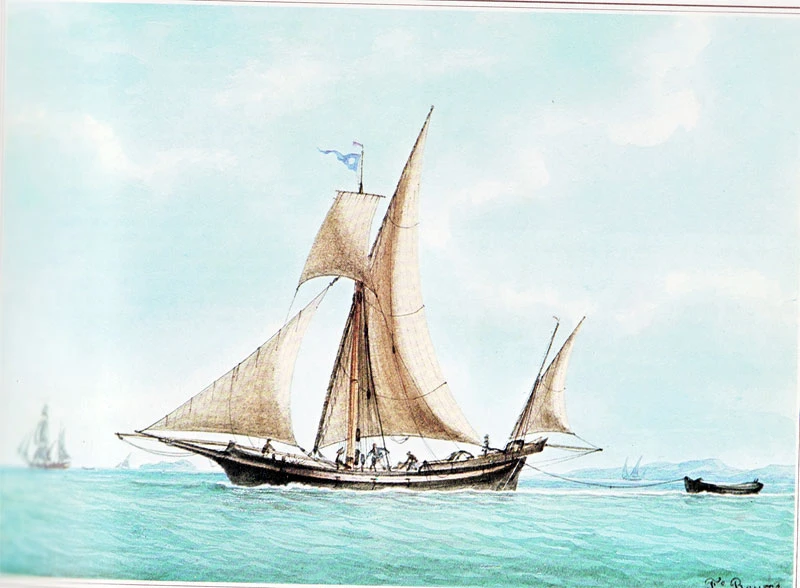

# Decisions: package 90, the Spanish and Mediterranean ships (the owner's round, November 2026)

**Revised 2026-11-20 on the owner's three answers of that day.** The owner answered three
questions put to them that day, verbatim: the three-decker's source, "Use PB-039 (Recommended)";
the tartane's main's rake, "Use the rake which provides the better sailing characteristic, upright,
or slightly forward raked."; the tartane's builder, "Start it (Recommended)". This revision records
them in Part F and adds a dated line under questions 4 and 10. Nothing else is re-opened.

**Revised 2026-11-19 on Winfield's passages sent by the owner, and the owner's answers of that
day.** The owner sent the passages of Part D they found, with their readings of Monleón's tartane
and polacre prints, and said, verbatim: "I went through Winfield for some of the requested
passages, I was not able to find everything requested, so you shall have to fill in some things
from other research or judgement". This revision:
- marks Part D item by item **supplied**, **partly supplied** or **not found**, with where each
  fact now stands (VR-Sp §7 to §17) and what fills a gap (other research, or judgement, by the
  owner's word);
- records in Part F the owner's four answers of 2026-11-19, verbatim: the polacre's mizen topsail
  ("Carry it"), *Virgen del Carmen*'s row ("Quite honestly, I do not know."), the ground report's
  count over twenty ("Go ahead") and the tiller step's seven files ("Widen the card");
- adds a dated line under questions 4, 5, 8 and 9 and in Part E's polacre where a passage bears
  on what was settled. Nothing settled is re-opened.

**Revised 2026-11-18 on the owner's decision of A1d (the lead's note of 22:35 UTC, nudge 19).** The
one choice that came back to the owner with the scope card, the strain of a lateen taken aback, is
decided: **built**. Their words, verbatim: "A lateen taken aback should increase the strain on the
mast, as a backed square sail does, so that on the worse tack and not dipped, the sail may strain
the mast and, in high enough wind, risk damage." This revision records it in question 3 ("Decided
by you") and in Part F, re-writes question 3's "In play" line on being taken aback and what it asks
of the engine, and gives the figures that come with it, each judgement for the lead's ruling.
Nothing else in the sheet changes, and nothing more is asked of the owner in it.

**Revised 2026-11-18 on the lead's note of 11:35 UTC (nudge 18).** The lead ruled the figures
question 3 left to them (the plan's §13.1), each as JUDGEMENT, and found that one of them, the
strain of a lateen taken aback, rests on a premise the engine does not hold: in the game a lateen
is never aback. That one comes back to the owner as a choice, which the lead puts with the scope
card (question 3, "One choice comes back to you"). The in-play figures of question 3 are measured
again at the ruled time to shift a yard. Nothing else in the sheet changes.

**Status (2026-11-18): answered. Third draft, 2026-11-18, on the owner's answer to question 3.**
The owner agreed nine of the ten questions as picked and re-opened the third, how the lateen ships
go about, with a shape of their own (their words in Part F, verbatim; the lead's note of 2026-11-18,
04:30 UTC, nudge 17). This draft records their answers in Part F and marks the nine settled as
picked. It re-drafts question 3 on their shape, with what the period sources say
(`Research-LateenGoingAbout-2026-11.md`, **GA**), what it means in play and how each choice is
ordered. Nothing more is asked of them in it. The rulings it leaves are the lead's (the plan's
§13.1), **given on 2026-11-18 (nudge 18)**; one came back as a choice (question 3), **decided by
the owner the same day: built (nudge 19)**.

The second draft (2026-11-18) was revised the same day on the critic's reading, with the designs'
second drafts: question 3's evidence (Willaumez's tacking polacre is a square-rigged one), question
4 (her main's rake asked in place of her headsails, which are judgement; her size in plain words),
question 5 (no length of a 30 is known), questions 7 and 10 (the *Diana*'s 1809 drawing; the
three-decker's hull), question 8 (the soldiers' other way), Part D's units, and Part E (the
polacre in two files).

This sheet holds:
- **ten questions.** Each gives the pick first and what it means in play, with a pointer to the
  evidence. The research notes and designs behind each are named under it.
- **the passages of Winfield's Spanish volume to ask for**, by title and class (Part D).
- **a short list taken as recommended** unless the owner says otherwise (Part E).

The answers go into Part F verbatim when they are given, and into the plan's §0 and each design's
open section.

**How to answer.** "As recommended unless indicated" answers every question with its pick, in the
owner's own form of 2026-10-27. A question answered by its letter takes that way. Questions for
the lead are in the plan's §13, not here. Nothing is built until the scope card is agreed.

**The documents cited:**
- **Eng**: `Design-Package90-Engine.md`.
- **Tar**, **Pol**, **Xeb**, **Dia**, **Con**: the research notes, `Research-*-2026-11.md`.
- **GA**: `Research-LateenGoingAbout-2026-11.md`, the period's word on going about under a
  lateen (2026-11-18).
- **Tar-D** and the rest: the designs, `Design-Ship-*.md`.
- **VR-Sp**: `VesselReferences-2026-11-Spanish.md`.

---

## Part A. The package

### 1. When the build begins, and in what order

**Settled 2026-11-18, as picked:** "I agree with the proposals" (the owner; Part F).

The rule since 15 November is that the gate of milestone 7 comes before any new building, unless
you say otherwise.

**My pick: after the gate, then two roads at once.**
- **Until the gate closes, only documents.** That means the critics' readings, the second drafts,
  the plans measured, and Winfield's passages. Nothing of package 90 reaches the trunk while you
  are testing.
- **Then two roads at once.** Each ship is built in a cloud session of her own and merged here:
  - the ship-rigged road: the *Diana*, then the three-decker;
  - the lateen road: the engine's lateen work first, then the tartane, the polacre and the xebec as
    their pieces land.

**In play:** the *Diana* is the first new ship in the harbour, a few days after the build begins.
The tartane is the first lateen, and the xebec comes last. You can try what has landed at five
stopping points.

| | My pick | The other way |
|---|---|---|
| 1a. When | after the gate | now, before the gate: the trunk would change under your testing |
| 1b. Order | two roads at once | one ship at a time in the lead's order (the tartane, the polacre, the xebec, the *Diana*, the three-decker): slower, with less for the lead to read at once |

*Evidence:* the plan's §2 and §9; `docs/dev/ScopeCards-BeforeTheGate.md`; Dia-D §0 (the *Diana* is
the smallest build).

### 2. Item 37: the shipbuilding script's copy of how hard a sail pulls

**Settled 2026-11-18, as picked, (a):** "I agree with the proposals" (the owner; Part F).

**The fault, in plain words.** The game rates each studding-sail boom for the wind it should stand.
The shipbuilding script keeps its own copy of how hard each kind of sail pulls. Its figure for a
studding sail is about a seventh lower than the figure the sailing itself uses. So every
studding-sail boom is rated a seventh weaker than intended. It was a slip in one table in package
10, not a choice.

**My pick: (a) mend the cause.** The script reads the sailing's own figures, rounded as it rounds
them now, and a test keeps the two together.

**In play:**
- A studding-sail boom stands about a knot more wind. It begins to strain at about 16½ knots in
  place of 15½, and may carry away from about 20 in place of 19.
- A frigate running in 32 knots with her studding sails set no longer loses a boom in the first
  seconds, before her people can take them in.
- Nothing else of any ship changes. 74 figures move in 9 ship files, all of them boom ratings.

**What is pinned, and moves:**
- truth 35's last clause, re-stated for the intended rating;
- the frigate's six-points studding test, measured again;
- five records that say no figure moved, which will name the booms;
- seven byte pins, which pass again once the files are regenerated.

**The other ways:**
- (b) Keep 1.25, and write it down as a judgement: light booms rated low on purpose, so that they
  whip and go first. That is truth 35's story.
- (c) Lower the sailing's own studding curve instead. It moves every ship's speed with studding
  sails set. Not recommended.

*Evidence:* Eng §1.1 to §1.5. This is settled before any new ship file is generated, since the
*Diana* and the three-decker carry studding sails.

### 3. How the lateen ships go about

**Answered by the owner, 2026-11-18, in a shape of their own** (Part F, verbatim): "Is the
judgement to only wear backed up by period sources? If not, and tacking was sometimes done, as I
know it is done on more modern lateen vessels, it might at least be included as an ordered
evolution, or, we might implement lateen main vessels as we do others, tacking and wearing
normally with their evolutions. We may also consider that lateen vessels may or may not dip the
lateen when tacking, it being preferred but not necessary. This is a larger engine addition, but
we can include it in the planning."

**What the period sources say** (GA, read for your question):
- **None read says a lateen vessel could not tack, or never did.** The one "never" is of an Indian
  boat, the Bombay dinga (Lescallier pp. 463-464).
- **The yard was changed "pour virer de bord"**, which is going about either way (Lescallier
  p. 378). Every period word for changing a lateen's yard is tied to going about either way
  (Lescallier p. 378; Willaumez, MUDER; O'Scanlan, CIMAR). The same words for a fore-and-aft sail
  mean its gybe (Röding, GIEPEN; Romme, TRELUCHER).
- **The board sailed with the yard left on the mast has a name in four dictionaries**, and two of
  them describe going about and holding the new board so (Stratico 1813; O'Scanlan 1831).
- **A lateen taken aback in a strong wind could cost the mast** (Forfait p. 119).
- **"Worn, not tacked" came from the package's brief**, not from a source.

So your own knowledge of lateen vessels tacking stands as the judgement, said as one, and the
design follows it.

**What is built, on your shape:**
- **A vessel with a lateen main tacks and wears as other vessels do.** Each is an ordered evolution
  with her own words, hands and time.
- **Changing the yard round the mast is a part of either, which may be done or left.**
  - Done: in stays once her head is through the wind, or in the wear once the wind is aft. The
    yard is peaked up and passed round the mast, never lowered.
  - Left: she sails the new board on the bad hand, the sail against the mast and drawing less,
    until she is ordered to shift it.
- **The polacre** tacks and wears as a brig does with her square main. Her two lateens are changed
  or left in the same way.

**How each choice is ordered:**
- **For one going about**, in the order's own words: `tack ship and shift the lateens`, or `tack
  ship and leave the lateens`; the same with `wear ship`.
- **By default**, by her practice: shifted in stays and in wearing (your "preferred"). It is
  changed for the cruise by an order of its own, for example `leave the lateens in stays`. A
  standing order can set it too as the wind crosses a figure: one for when the wind falls under
  12 knots, and a second for when it rises over 12 again. A standing order acts at the crossing,
  not all the while the wind stays under it. (The order is said with the verb first, `leave the
  lateens in stays`, since an order that begins "in stays," is read as a hail: the lead's
  ruling.)
- **By itself**: `shift the mainsail` puts right a lateen left on the mast. It is refused in words
  when the sail is already to leeward. To bend a new mainsail from the sail room instead, the
  order keeps its "for": `shift the mainsail for a new one` (the lead's ruling).
- **The game's own captain** keeps the ship's practice, with three judgements of their own:
  - in a strong breeze, over 22 knots, `put her about` wears her, and so does an order to steer
    or shape a course across the wind, since a lateen taken aback in a strong wind could cost the
    mast;
  - in fine weather, under 12 knots, they leave the yards in stays, and shift them once a board on
    the bad hand has run half an hour or the wind freshens;
  - they shift a lateen left on the mast after a gybe, or after a shift of wind round ahead, as
    they dip a lugger's lugs.

  Your own `tack ship` is always a tack.

**In play.** Measured on the engine's stand-in tartane in 15 knots, the first quarter of an hour,
with her own yards' times at the lead's ruled rate (8.7 seconds a metre of yard, her trader's
eight hands: the great yard in about 4½ minutes, then the mizen in about 2). The bad hand's loss
and the time to shift a yard are judgement.

| The stand-in tartane | Done in | Ground lost to windward |
|---|---|---|
| Tacked, the yard left | about 2½ minutes | 330 m, then about 5 per cent of her speed on the bad hand |
| Tacked, the yards shifted in stays | about 7 minutes, the great yard and then the mizen (4 with hands for both at once) | 520 m (535 with hands for both) |
| Worn, the yards shifted | 8 minutes | 800 m (730 with hands for both) |
| Worn, the yard left | 8 minutes | 715 m, then the bad hand as above |

- **So leaving the yard pays on a short board, and shifting it pays on a long one.** On the
  stand-in tartane the turn comes after about an hour (it was three quarters of an hour at the
  quicker time of the earlier draft). That is what the late Provençal record says lateen sailors
  did: they kept their boards on the bad hand short.
- **Taken aback in a breeze.** In the game today a lateen is never pressed aback: with the wind on
  the wrong side it collapses and flaps, so her head in the wind's eye costs her way and nothing
  else, in 15 to 35 knots (measured). **You decided that the game gives it the danger** (below):
  with it built, a lateen whose head goes through the wind, or which a shift of wind takes aback,
  is pressed against its mast and strains its yard and mast in a strong wind; and one left on the
  bad hand strains them in a gale. In your own going about it costs a few metres (measured on the
  stand-in ships in 15 and 25 knots: no more than 13 metres more lost), since the hands let the sail
  draw on the new side, or begin to shift it, as soon as her head is round.
- **The xebec carries no head sail.** After a tack she eases her mizen to bring her head off;
  without that her stand-in lies stalled across the wind.

**What it asks of the engine:** a larger addition than the second draft's, as you said: four
steps in place of one (Eng §14, A1a to A1d), about seven and a half more working days of the engine
track than the second draft's, five of them for going about and two and a half for the strain aback
you decided (the plan's §11 and §14; three in the earlier draft of this sheet, before the lead's
reading found the yard's change woven into eleven places of the bilander's). The build is about
half a week longer for it: three and a half to four and a half weeks.

**The lead's rulings (2026-11-18, nudge 18; the plan's §13.1)**, each judgement:
- the bad hand's loss: the lugger's, a third of the sail's area;
- the time to shift a yard: the lugger's own rate, 8.7 seconds a metre of yard; one able hand for
  every 2½ metres, at least four;
- the yard's heel passes abaft the mast (Willaumez; O'Scanlan's forward recorded);
- the captain's winds: 22 knots to wear in place of a tack, 12 knots to leave the yards in stays,
  half an hour on the bad hand before shifting;
- the orders' words, as written above.

**Decided by you, 2026-11-18: the strain of a lateen taken aback is built** (the choice the lead
put to you with the scope card; your answer through the lead's note of 22:35 UTC, nudge 19). Your
words: "A lateen taken aback should increase the strain on the mast, as a backed square sail does,
so that on the worse tack and not dipped, the sail may strain the mast and, in high enough wind,
risk damage." It was put to you as (a) not built (the pick) or (b) built; you chose built, and asked
for two things: a lateen taken aback loads its mast as a backed square sail does; and a lateen on
the worse tack and not dipped, left lying against its mast, may strain the mast too, and in wind
enough risk damage.

**What is built, in plain words** (Eng §2.4.3; each figure judgement, for the lead's ruling):
- A lateen whose head goes through the wind, or which a shift of wind takes on its other side, is
  pressed back against its mast: it stands aback and pushes her astern, and its pull bears on its
  yard and its mast, more than when it draws. It is not pressed while she only luffs; the sail then
  shakes, as now.
- **Aback**, the great yard begins to strain from about **28 knots** and may carry away from about
  **35**. A mast that carries only its lateen goes with its yard; the tartane's mainmast, which
  carries her topsail too, from about 38.
- **On the bad hand**, lying against its mast, the yard strains from about **45 knots** and may
  carry away from about **55**.
- The damage is the game's own: a spar strained "working under the press of sail", one about to go
  "bending like a whip", and one carried away with its sail, as any spar now. Nothing new.
- The sail aback will not come in till she pays off (Forfait p. 119).
- **Your captain is never dismasted by their own book.** They wear her over 22 knots and tack her
  under it; in stays a lateen is aback only for the seconds until the hands let it draw on the new
  side or begin to shift it, and the yards measured in that tack stood at about half their limit in
  22 knots, and just over it only in the top of a squall (32 knots), never near the risk. They lie
  on the bad hand only under 12 knots, where the yards bear a tenth of their limit for as long as the
  board lasts.
- Your own `tack ship` in a gale, or a sail left aback by a shift, is where the danger is.

**What it replaces:** the second draft's pick, "decided by her main sail". In it a lateen main was
worn only and `tack ship` was answered in her words, with the polacre alone tacking.

*Evidence:*
- GA §2 to §5;
- Eng §2.2a (the measures), §2.3 (the design), §2.4 (the costs and risks), §14;
- each hull's going about in her design: Tar-D §5.4, Xeb-D §5, Pol-D §5.3.

---

## Part B. The hulls

### 4. The tartane: her size, her main's rake, her tréou

**Settled 2026-11-18, as picked:** the *Humble*, her main raked 3° forward, the tréou carried. "I
agree with the proposals" (the owner; Part F).

*2026-11-19:* the owner's reading of Monleón's print and the other tartane prints they have seen
gives her **one headsail** and **a loose-footed square topsail with no lower yard** (Part D, T2;
VR-Sp §9). The one jib stands, now on their reading; the tréou stays carried, its yard sent up with
it and not crossed in plain sail (Tar-D decision 9).

*2026-11-20:* Chapman's Pl. LXII No. 16 draws a tartane's main upright (Tar-D §4.1). Asked whether to
revisit the 3° forward, the owner answered: "Use the rake which provides the better sailing
characteristic, upright, or slightly forward raked." (Part F). And for her builder: "Start it
(Recommended)".

*Your watercolour, held in the tree: the reference for her rig.*

**My pick:**
- **Her size: Forfait's *Humble*.** She is 100 tonneaux and 20.4 × 6.6 m, with a topsail and a
  mizen, and she is drawn on Chapman's lines widened to her. Forfait gives your rig to a tartane
  of her size, but for a topgallant over her topsail, which is left out. By Forfait's table, a
  smaller one carries no mizen.
- **Her main raked a little forward, 3°.** Your decision 11 says "one raking mast"; your
  watercolour shows her main near upright; no text gives a tartane's main a rake. A little rake
  keeps your word and still looks like your picture.
- **The tréou carried.** It is a square sail on a yard below the topsail. She sets it when running
  before the wind, or when it blows too hard for the lateen, and never in plain sail.

**In play:** a beamy coaster about a quarter longer than the cutter on deck (a third longer on the
water, as first drafted; **2026-11-20:** a fifth longer, by her measured waterline of 18.47 m), whose lateen yard (24 m) is longer than her hull. She has one big jib: your decision 11
leaves her headsails to judgement, and Lescallier, Steel and Röding give her one (the images
README and the lead's Spanish note read two in your watercolour; that reading is recorded, and your
eye may overrule the judgement). Before a gale she sets her square sail.

| | My pick | The other ways |
|---|---|---|
| Size | the *Humble*, 20.4 × 6.6 m | the *Espiègle*, 16.8 × 5.8 m (by Forfait, with no mizen); or Chapman's war tartane, 18.5 × 5.2 m |
| The main's rake | 3° forward, a little | upright, as your watercolour shows it; or raked further, as "raking" might mean |
| The tréou | carried | left out |

*Evidence:* Tar §2.1 (Forfait's Table II, p. 134, read on the page image), §3.1 and §3.3; Tar-D
§4.1 and §16.1.

### 5. The xebec: which size, and the chambequín

**Settled 2026-11-18, as picked:** the small class on *Minorca*'s hull; the 30 and the chambequín
booked. "I agree with the proposals" (the owner; Part F).

*2026-11-19:* the *Gamo*'s length is now known, 38.92 m of eslora by 9.38 m (Part D, X2); the
Spanish rows of the small class are narrower for their length than *Minorca*, and *Gitano*'s
draught is a Spanish plan of the 14 (Part D, X1; VR-Sp §13; Xeb-D §2.2). Nothing settled moves.

Winfield gives two sizes: 14 to 22 guns with 4-pounders, and 30 to 32 guns with 8-pounders.

**My pick:**
- **The small class**, on the hull of Greenwich's *Minorca* (ZAZ4270, an 18-gun xebec of 1778,
  29.5 × 9.3 m). The 30 is booked as a later file.
- **The chambequín booked**, as a later file of the same module.

| | The small class (my pick) | The 30 |
|---|---|---|
| Size | a brig-sloop's length, 29.5 m on *Minorca*'s hull, with three long yards over her (the class runs to the 20-gun xebecs of 38 to 39 m) | longer and heavier, by how much no source read says: the *Gamo*'s length is not given, and Winfield's entries are asked (X2) |
| Guns and men | 14 to 22 light guns; about 113 men (*África*'s 75 seamen and 38 soldiers) | 30 to 32 guns; 319 men |
| The record | *África* (1799); *Vives* (1806); the 22-gun xebec that out-pulled the *Pasley* at her sweeps (1801); the regency's 18 of 1815 | the *Gamo*, taken by the *Speedy* (1801) |
| Her roles | the King's, the regency's, a privateer's and a trader's | the King's |

**The chambequín** is a xebec hull square-rigged on all three masts. She is cheap in the engine,
since she would class as a ship. But no figure of her spars was found, so she waits for one.

**The other ways:**
- the 30 for the file;
- the chambequín as a fit now, her spars by judgement.

*Evidence:* Xeb §2.3, §2.4 and §3.6; VR-Sp §3; Xeb-D §18.1.

### 6. The xebec's sweeps

**Settled 2026-11-18, as picked:** now, as a fit. "I agree with the proposals" (the owner; Part F).

**My pick: now, as a fit.**
- Sixteen sweeps of three men each, carried by the King's, the regency's and the privateer's
  fits.
- She pulls in a calm or under sail.
- The 48 men are taken from the sails and the guns while they pull.
- She stays a ship: she strikes her bells, and the game never takes her for a boat.

**In play:** in a calm she makes about 2½ knots at first, tiring to 1½ in three hours. A brig at
her own sweeps falls behind her.

**The other way:** words only, built later. She lies becalmed as any ship does.

**Cost:** one engine step of its own (A7), about two days.

*Evidence:*
- Xeb §4: Willaumez's sweep port between each pair of guns; Forfait p. 126's galley; James III
  p. 149.
- Xeb-D §6.
- Eng §5: today a ship given a boat's oars becomes a boat, with no bells.

### 7. The *Diana*'s guns when she was taken

**Settled 2026-11-18, as picked:** the owner's three fits kept, and "Danish 1807" added. "I agree
with the proposals" (the owner; Part F).

*Her own plan, held in the tree (CC BY 4.0. Fuente: Archivo Histórico de la Armada Juan Sebastián
de Elcano / Biblioteca Virtual de Defensa).*

Your ruling of 6 November gives Winfield's three fits:
- 20 × 24-pdr carronades as captured;
- 20 × 30-pdr carronades as first rearmed, which is her plan's own;
- 1817's 12 × 12-pdrs, 8 × 30-pdr carronades and 4 × 3-pdr obuses.

Since then, two sources of her own time have been found: her own papers (Roos 1957, p. 94, written
from them), and the caption of a drawing of her signed "Thomsen pinx 1809" (perhaps her officer of
that name). Both say the Danes armed her with 16 × 30-pdr carronades and 4 long 8-pounders.

**My pick: keep your three, and add a fourth, "Danish 1807",** from her papers. Ask Winfield's
source for "as captured" (passage D1).

**In play:** under Danish colours off Cartagena in 1807, she shows a long gun at each end of her
battery and carronades between. From 1809 on she is as Winfield has her, and the 1810 fit is the
default.

**The other ways:**
- Winfield's three alone;
- her papers in place of "as captured".

*Evidence:* Dia §4 and §8; Dia-D §17.1, question 1.

### 8. The three-decker: her fits, her soldiers, her rank

**Settled 2026-11-18, as picked:** one rebuilt hull for both fits; about 100 of her 839 as soldiers,
for now; size rank 5. "I agree with the proposals" (the owner; Part F).

*2026-11-19:* Winfield's breakdown (G3) is read, so the interim "about 100" gives way as the pick
said it would: her company by the regulation of 1788 for the 1797 fit (877, of whom 225 soldiers,
168 infantry and 57 infantry-artillery) and by that of 1803 for the 1809 fit (1,015, of whom 275;
a company being the file's, the 1809 figure is recorded as a departure, as the polacre's corsair's
is); her own 839 in the note (Part D, G3; VR-Sp §15; Con-D §6.1). Whether her soldiers then leave
crews empty under the engine's rule is measured at her build and goes to the lead if they do.

**My pick:**
- **One hull, as rebuilt (1786 to 1793), for both fits:**
  - 1797, 112 guns, the default (Cape St Vincent);
  - 1809, 116 guns: the 1803 alteration, with obuses on the poop and quarterdeck and the upper
    deck's 18-pounders back.

  The obuses are carried as carronades of their calibre, and called "obús" in her words.
- **Her 839 counted with about 100 soldiers**, so that every gun of a side is manned at the beat:
  for now, until Winfield's breakdown of her company (G3) is read. The game's marines serve no long
  gun, so with about 160 soldiers (the 74's share) three or four crews would stand empty.
- **Size rank 5, a class above the 74.** Frigates and cruisers keep away from her as from a 74. A
  lone 74 does not avoid her of itself.

**In play:**
- At quarters, the lower, middle and upper decks report their crews in turn, with every gun manned.
- `fire the starboard middle deck` fires sixteen guns.
- A frigate's captain gives her a wide berth.

| | My pick | The other ways |
|---|---|---|
| Soldiers | about 100 of the 839, every gun manned (for now) | about 160 by the 74's share (judgement: Winfield gives the 839 unbroken), with the engine's rule changed so that her marines serve the long guns (for her alone) |
| Rank | 5 | 4: every ship of the line one class |

**What the tops would make out at four miles.** Her own plan, PB-039, shows three tiers of 15, 16
and 16 ports a side, a beakhead, and two tiers of quarter galleries. The game's 74 has two tiers
of fourteen.

*Evidence:* VR-Sp §4; Con §3 and §4; Con-D §6, §8.3 and §17; Eng §6.

---

## Part C. Rules and sources

### 9. How a Spanish or Danish gun's pounds are written

**Settled 2026-11-18, as picked:** as her own navy named it. "I agree with the proposals" (the
owner; Part F).

*2026-11-19:* the book gives the libra as 0.4608 kg, 1.59 per cent heavier than the English pound,
one ratio for every calibre (Part D, G2; VR-Sp §7). By it a Spanish broadside reads light by about
1.6 per cent, not the "1½ to 8" below; the book's broadside pairs (1.079) do not follow its own
libra and stay as given. The way settled does not change.

A Spanish pound is not an English pound, and the sources disagree on the difference:
- James adds a seventy-second: 1.014.
- Winfield gives the broadsides in libras with the book's pounds beside them, and those come to 1.079.

**My pick: as her own navy named it.** A Spanish 36-pounder is filed as a 36-pounder. Winfield's
pairs are set down in its note as the book gives them, and the ratio is never re-derived.

**In play:** her log and her deck say "the 36-pounders", as her people did. Her broadside reads a
little light, by 1½ to 8 per cent, and her notes say so.

**The other way:** the English weight in the file, so that the engine sees a "38.85-pounder", with
the words taken from a separate key so that they still say 36. The weight is then true, at the
cost of a new key in the engine.

*Evidence:* VR-Sp, "Units"; Con §3.3; Dia-D §17.1, question 2; Eng §6.3.

### 10. Four questions on the sources

**Settled 2026-11-18, as picked:** yes, yes, yes once vetted, and not now. "I agree with the
proposals" (the owner; Part F).

*2026-11-20:* the second (the three-decker's hull) answered again by the owner, in place of their
choice of the *San Josef*'s sheets: put as "Draw her hull from PB-039 instead?", their answer "Use
PB-039 (Recommended)" (Part F). The three-decker's hull is drawn from PB-039, her own plan as built;
ZAZ0100 to ZAZ0103 stay as the comparison, and settle her sixteenth lower port pair, the aftmost
(Con-D, revised 2026-11-20). Greenwich served the sheets at 1,280 px only, too small for her lines
(`ships-design/pages-concepcion.md` §1.2, §11).

**My pick:**
1. **Yes: hold PB-039**, the *Concepción*'s own plan of 1779, in `docs/references/images/` with
   its credit line, as the *Diana*'s plan was held. It comes from the Archivo Histórico de la
   Armada, through the Biblioteca Virtual de Defensa (record 1026905, CC BY 4.0).
2. **Yes: draw the three-decker's hull from her sister's lines as rebuilt**, Greenwich's ZAZ0100 to
   ZAZ0103: the *San Josef*'s lines and decks as fitted at Plymouth, 1799 to 1801. They are read on
   Greenwich's site and cited by object number, never copied, as the 74's draughts were and as the
   xebec's *Minorca* is; reading them needs no permission. What is asked is which hull is hers:
   her sister's as rebuilt, as she sailed from 1793, or her own plan as first built (PB-039), the
   other way.
3. **Yes: hold the *Diana*'s 1809 drawing** (signed "Thomsen pinx 1809"; Frederiksborg, inv. no.
   3561; the original public domain by age), once a museum image with its terms is found and its
   artist, date, licence and namesake are vetted, as the images README's rows are. Roos's 1957
   reproduction is not offered until its status is vetted too.
4. **Not now: her Danish draught** (at the Rigsarkivet, or the M/S Museet for Søfart). Her Spanish
   plan of 1809 is already her own lines, at the highest rung of evidence. The Danish draught would
   add only her sweep ports and her stern as built. Booked.

**In play:** with 2, the three-decker's hull is drawn as she sailed after her rebuilding. Without
it, her hull is scaled from her plan as first built.

*Evidence:* Con §2.3, §2.4 and §11; Dia §9.

---

## Part D. Winfield's passages to ask for, by title and class

**The books:**
- Winfield, Tredrea, García-Torralba Pérez and Blasco Felip, *Spanish Warships in the Age of Sail,
  1700–1860* (Seaforth, 2023), in the owner's edition;
- two entries of Winfield's *British Warships in the Age of Sail, 1793–1817*.

The facts go into the tree by page, in the lead's words (as VR-Sp does), and never the text.
**Waited on** marks a passage a ship's file waits for. The others would improve her file.

**Marked 2026-11-19, item by item**, on the passages the owner sent that day: **supplied**,
**partly supplied** or **not found**. The owner, verbatim: "I went through Winfield for some of the
requested passages, I was not able to find everything requested, so you shall have to fill in some
things from other research or judgement". So **nothing waits on Winfield any longer**: what was not
found is filled from other research or by judgement, each marked so in the design it reaches. The
facts sent are set down by page in VR-Sp §7 to §17, cited "Winfield et al. 2023, p. N".

**The book's front matter (for every Spanish hull)**
- **G1.** Measurement: the eslora, manga and puntal as measured; arqueo against displacement; which
  length the rows' "length" is.

  → **Supplied** (pp. 41-46; VR-Sp §7). The four figures of a row are eslora, quilla × manga ×
  puntal: the eslora on the lowest planked deck over both overhangs (the rows' "length", neither the
  length overall nor the British gun deck's), the quilla the straight keel, the manga the greatest
  beam at mid-length, the puntal the depth of hold, about half the manga. The tonelada de arqueo is
  capacity, about 1.42 m³; a displacement is marked "(disp.)". The pie de Burgos is 278.635 mm.
  Whether the manga is inside or outside the plank is not said.
- **G2.** Ordnance:
  - the libra against the English pound, calibre by calibre;
  - the iron guns' weights by calibre;
  - the carronades (the 30-pounder's weight and shot);
  - the obús: its weights, charge, crew and when it came in (the 48-, 24- and 3-pounder).

  **Waited on** by the three-decker's pounds by calibre.

  → **Partly supplied** (pp. 41-46; VR-Sp §7, §16). **The libra: 0.4608 kg**, 1.59 per cent heavier
  than the English pound, one ratio for every calibre, and a "32pdr" fires 32 libras: the
  three-decker's pounds by calibre no longer wait (Con-D §5.3). The ordinance of 1803 places the 48-
  and 24-pounder obuses by deck (VR-Sp §16). **Not found:** the iron guns' weights, the carronades',
  and the obús's weights, charge, crew and date: to come from other research (the period's Spanish
  artillery treatises, for example) or judgement.
- **G3.** Manning: the dotación of a 112 and of a corvette of 20, by kind (officers, warrant
  officers, the brigades' gunners, seamen, boys, soldiers). **Waited on** by the three-decker's
  bill.

  → **Supplied** (p. 1446 and the two pages following, and the table of the Regulation of 16
  October 1803; VR-Sp §15). A 112 by kind in 1788 (877 in all, the book's Total of 848 leaving out
  the commissioned and major officers) and in 1803 (1,015); a corvette of 18 to 22 guns in 1788
  (138); the xebecs' too. The soldiers are the infantry and the infantry-artillery. The 1788
  complements are for peace, with a war increase; the 1803 table has no corvette. The three-decker's
  bill no longer waits (Con-D §6.1), nor the *Diana*'s split (Dia-D §6.1).
- **G4.** Any masting or rigging rule (a reglamento de arboladura), and whether the mizen was on a
  lateen yard or a gaff in 1797 and 1809.

  → **Not found.** Her rig stays Steel's rule and the 74's proportions, a lateen mizen, by judgement
  (Part E).

**The tartane** (pp. 1249 to 1252, held in the lead's words)
- **T1.** The tartanas, pp. 1249 to 1252, in full:
  - the seven by name;
  - how and when each was acquired: bought or chartered, and from which French builders and which
    Spanish one;
  - particulars in pies de Burgos with the book's metres, and tons;
  - guns by calibre, in libras with the book's pounds;
  - men;
  - the coastguard's stations and duties;
  - fates.

  → **Partly supplied** (pp. 1252-1253; VR-Sp §9). Seven by name (*San Cayetano*, chartered in
  1741; *San Nicolás* and *Santo Espíritu*, bought from France after 1762, *Misericordia* perhaps
  the third; *Dolores* and *Todos los Santos*, bought 1778; *Las Ánimas*, a tartana armed as a gunboat,
  lost in the Bay of Roses in 1795), with how they came and their fates. **Not found:** particulars,
  tons, guns, men, the builders' names and the stations. The tartane's company and the coastguard's
  guns and men stay judgement (Tar-D §6, §7).
- **T2.** Monleón's print of a tartana at rest, p. 1249: its caption and the Museo Naval's number;
  whether a lower square yard stands under the topsail; how many headsails.

  → **Partly supplied** (the owner's reading, 2026-11-19; VR-Sp §9). **One headsail; a loose-footed
  square topsail with no lower yard**, in this print and the others the owner has seen. **Not
  found:** the caption and the museum's number (the print's reproduction too poor to send).
- **T3.** Any section on the navy's small coastguard craft of the same service (the guardacostas,
  and the lateen místicos and faluchos), by title and class: their companies and duties.

  → **Partly supplied** (pp. 168-169 and 1195-1201; VR-Sp §10, §11). The coastguard's work and whose
  it was (the Treasury's, but the navy's from 1802 to April 1805); the místicos with their
  dimensions, companies (23 to 72) and guns. **Not found:** the faluchos.

**The polacre** (pp. 1083 to 1084)
- **P1.** The polacras of about 1780 to 1818, pp. 1083 to 1084 and any that follow. For each of the
  eight:
  - her name, and her origin (built, bought or taken);
  - her dimensions in pies de Burgos with the book's metres;
  - her tons, guns, men and fate;
  - any account of how her masts and yards were handled.

  **Waited on: her size.**

  → **Supplied** (pp. 1083-1086; VR-Sp §12), but for the handling of the masts and yards, not
  found. The eight entries, with what each gives. **Her size: *Angel de la Guarda*** (1818), 25.08,
  22.15 × 7.52 × 3.34 m, 71 men, 2 × 12 and 8 × 8 bronze, the one whole row (Pol-D §2). *Virgen
  del Carmen*'s row gives three figures, 22.15, 19.20 × 4.20 m, and whether the third is her beam
  or her depth is **recorded as unknown**: the owner, 2026-11-19, "Quite honestly, I do not know."
  (Part F).
- **P2.** Whether a polacra *San José* is among them (the ship taken at Fuengirola on 28 October
  1800, James vol. 3 p. 33), and her row.

  → **Not found:** no *San José* among the eight entries sent. The polacre of war's *San Josef*
  fit stays James's.
- **P3.** The caption of Monleón's polacre print, p. 1084, with its date and the Museo Naval's
  number. And in your own words, the hull it shows: her stern, her head, her ports, her sheer.

  → **Partly supplied** (the owner's reading, 2026-11-19, quoted whole in VR-Sp §12). Three
  headsails; the fore lateen on a foremast raked forward; the main and the mizen raked aft, the
  mizen about the fore's height with **a small loose-footed topsail** over its lateen, the lateen
  sheeted to a short boom over the transom; a lively sheer, a step in the rail for a raised
  quarterdeck, no gunports, a reasonably short bowsprit. Asked whether she should carry the mizen
  topsail, the owner answered "Carry it" (Part F). **Not found:** the caption, its date and the
  museum's number.
- **P4.** Any bergantín-polacra or polacra-goleta entries.

  → **Not found.**
- ***British Warships 1793 to 1817*:**
  - **PB1.** HMS *Calpe* (14), the polacre-sloop of 1801, and whether she was the *San José*
    (memory, unverified).
  - **PB2.** HMS *Fortune* (10), polacre, 1799: dimensions and tons.

  → **Not found** (not sent). Neither is needed now that *Angel de la Guarda* sizes her.

**The xebec** (pp. 1134 to 1136)
- **X1.** The jabeques of 14 to 22 guns: the ship entries after pp. 1134 to 1136, at least one
  class of 14 and one of 18, and *África* (taken 22 February 1799) and *Vives* (1806) if listed.
  For each:
  - dimensions in pies de Burgos with the book's metres, and tons;
  - men, seamen and soldiers apart;
  - guns by date;
  - her sweeps (remos), and the men to each;
  - her builder and yard;
  - any plan reproduced, with its archive number.

  → **Partly supplied** (pp. 1141-1158; VR-Sp §13). The xebecs from 1749 on, with dimensions,
  tons, guns by date, builders and yards, and men for some; ***Nuestra Señora de África* (ii)** of
  1775, 18 guns, all lateen, 23.85 × 6.34 m, 127 men (whether she is James's *África* of 1799 is not
  said); ***Gitano*** of 1753, 14 guns, 27.43 × 6.71 m in English feet as designed, **her draught
  reproduced (Museo Naval, PB_album_06_05)**; the *Cazador* class's plan (the Marqués de la
  Victoria's album, plate 17). **Not found:** *Vives*, seamen and soldiers apart, the sweeps (remos)
  and the men to each. The sweeps stay judgement (Xeb-D §6).
- **X2.** The jabeques of 30 to 32 guns, the *Gamo* (taken 6 May 1801) first: the same.

  → **Supplied**, but for her men (VR-Sp §13). **The *Gamo*: 38.92, 32.00 × 9.38 × 3.53 m, 435 t;
  24 × 8, 6 × 3 and 12 pedreros**; launched at Mallorca in 1770. Others of the 30 beside her. The
  1788 complement of a xebec of 30 to 32 guns is 293 (VR-Sp §15).
- **X3.** The chambequines (*Volante*, *Andaluz* (ii), and any others): their masting and their
  dates.

  → **Partly supplied** (VR-Sp §13). The dates: *Aventurero* converted 1765, *Andaluz* (ii) 1778,
  both for Buenos Aires; *Caimán* (1770) and Barceló's *San Antonio* (1772) rigged as chambequines;
  the *Murciano* class (1779) ship-rigged. **Not found:** any masting figure, and *Volante*'s
  conversion. The chambequín stays booked.
- **X4.** Anything on a jabeque's steering (wheel or tiller), her lying to, and her going about
  under the lateens. And the packet-boat of 18 that the Regulation sets beside the xebec of 18.

  → **Not found.** Her wheel, her lying to refused in words, and her going about stay as designed,
  by judgement (Xeb-D §5, §12).

**The *Diana*** (p. 930)
- **D1.** Her whole entry, p. 930:
  - her service line by line: her commanders, the voyage of November 1810, the date of the 1817
    survey, her end in 1832;
  - the source for "20 × 24-pdr carronades as captured";
  - the rule behind "335 t";
  - her rig, masting and steering, if given.

  → **Supplied, and holding nothing new** (p. 930; VR-Sp §17). The owner: "this is the entirety of
  it". It has only what VR-Sp §5 had; **none of the four asks is in it**. By G1, her 335 t is
  toneladas de arqueo, a capacity, not a weight (Dia-D §2).
- **D2.** The introduction to the corvettes' chapter (about pp. 900 to 930): how corvettes of 20
  were rigged and armed after 1800.

  → **Partly supplied** (pp. 904-906; VR-Sp §14). How they were armed (6- and 4-pounders and short
  guns of the carronade kind, many rearmed with 8s; after 1800 8-pounder ships called corbetas) and
  how the book draws its line at twenty guns. **Not found:** how a corvette of 20 was rigged.
- **D3.** Any other ship of France's allies seized in Spanish ports in 1808 and 1809.

  → **Not found.**

**The *Purísima Concepción*** (pp. 406 to 410)
- **C1.** The class, pp. 406 to 410, re-read for:
  - the keel: 190 ft 10 in (the book's feet and inches here are pies de Burgos and pulgadas, at
    0.2786 m a pie) is 53.17 m, and the book prints 53.12;
  - the rebuilt length: 220 ft 6 in, in pies de Burgos, is 61.43 m, and the book prints 61.30;
  - which length the "length" is (VR-Sp writes "Length overall"; the *Diana*'s plan reads it as
    the gun deck's);
  - any draught (calado) or battery height;
  - the 839 by kind;
  - what the 1784 sea trials found;
  - where the sixteenth lower pair of ports was cut;
  - whether she crossed studding sails;
  - her steering;
  - the captions of PB_0050 and J1945.

  **Waited on: her hull blocks.**

  → **Not found** (the class's pages not sent), but for two asks met elsewhere: **which length**,
  by G1 (the eslora, on the lowest planked deck; VR-Sp §4 relabelled), and **the 839 by kind**,
  by G3's regulations in its place (Con-D §6.1). The ordinance of 1803 confirms her 18-pounders in
  her third battery (VR-Sp §16). The keel's and the rebuilt length's digits stay as printed, the
  game taking the book's metres by the lead's rule; her draught, sills and rudder are measured on
  ZAZ0101 at her step 1, or judged. **Her hull blocks no longer wait on Winfield.**
- **C2.** The *Santa Ana* class (the 112s of 1784 on): their crew, and any masting figure.

  → **Not found** as a class; a 112's crew by G3.
- ***British Warships 1793 to 1817*:**
  - **CB1.** The prize first rate *San Josef* (1797): her British dimensions, the 114 of 1801, her
    850 men, and any sailing remark.

  → **Not found** (not sent). The British fit stays booked.

---

## Part E. Taken as recommended unless you say otherwise

- **The polacre** (Pol-D §17.1):
  - Monleón's rig, as you chose it: a lateen fore raked forward; a square pole main with course,
    topsail and topgallant; a lateen mizen; jibs on a long bowsprit.
  - A Mediterranean merchant hull of about 200 tons with a beak. Her size comes from Winfield's rows
    (P1) when they arrive. *2026-11-19:* they have; she is sized on *Angel de la Guarda* (25.08 m of
    eslora by 7.52 m), and by the owner's word she carries a small loose-footed mizen topsail over
    her lateen mizen, as Monleón's print shows it (Part D, P1 and P3; Part F).
  - Two files of one hull, since a ship's company belongs to her file and not to a fit: the
    trader's, sixteen men, unarmed by default or an armed trader with six long 6-pounders; and the
    polacre of war's, the Spanish navy's (the *San José*'s fourteen brass guns and 71 men) and the
    regency's cruiser as a role on fourteen small guns, her 80 men filed at 71 with the difference
    recorded.
- **The tartane** (Tar-D §16.1):
  - A second file for the coastguard, on the same hull: one class in two roles, as the brig and the
    merchant brig are. Chapman's eight 4-pounders, four swivels and about 34 men. Made out at a
    mile and a half as "a King's tartane, armed, a guarda-costa", the period's English for her
    service.
  - Her headsails by judgement, as your decision 11 leaves them: one great jib.
  - Her boat towed astern on passage.
  - Her name, *Saint-Pierre*.
  - The fisherman's description comes later, once a fishing-grounds file for the Gulf of Lion
    exists.
- **The xebec** (Xeb-D §18.1):
  - The trader as her own file: the merchant xebec, 18 men, on the same hull.
  - A second suit of small lateens, shifted in a gale. The square sails for running come later.
  - Steered by a wheel until a source says otherwise.
- **The *Diana*** (Dia-D §17.1):
  - As stiff as the frigate (GM 1.5 m), by her captain's word "stiff".
  - Her masts and yards by the rule the game uses for its frigate, on her size.
  - Her colours are the scenario's. Her file carries no nation.
- **The three-decker** (Con-D §17):
  - Her rig by Steel's rule and the 74's proportions until a Spanish rule is read, with a lateen
    mizen and no driver.
  - "The main deck" is answered in her words, naming her three decks. "The second deck" and "the
    third deck" are understood.
- **Every Spanish hull:**
  - A Spanish names list for her people (Spain's people are named in English today).
  - The obús carried as a carronade of its calibre. A howitzer's shells are left to a later
    gunnery package.
- **The tiller's words for every tiller-steered hull at once**, not just the new ones: the cutter,
  the lugger, the smack, the two schooners and the *Neufchatel*. Each is told "the tiller is shot
  away" and is repaired with a spare tiller. This is under your rule of 14 November that a fault is
  mended at its cause, for everything it reaches (Eng §10).
- **Two more older faults the package meets, mended for every ship by the same rule:**
  - the wear's "brace in the after yards" is said only where she has after yards;
  - the smack's topsail is handled as a topsail, not as a course (the plan §2).
- **No scenario in this card.**
  - Each new ship is offered from the harbour for a bare start, with her fits listed.
  - Her scenarios come in a card of their own: Cape St Vincent in 1797, Cartagena in 1807, a
    regency's cruiser off Algiers, a tartane bound for Toulon.
  - That card waits until the nations' table holds wars by date. Today it holds one year's picture,
    so Spain is Britain's enemy in 1810, when she was an ally.
- **The regency's cruiser** (`Design-SlaveryAndSuppression.md` §8):
  - A role with its own doctrine book, as the cruiser's is.
  - No seat for a player at it. A model's seat is refused in words until its brief is in the
    consent documents.
  - The xebec herself is open to you under Spain's flag.

---

## Part F. The answers (recorded verbatim when given)

**The owner, 2026-11-20**, on three questions put to them that day, verbatim:
- **The three-decker's source** (put as "Draw her hull from PB-039 instead?", in place of their
  choice of 2026-11-18 under question 10, her sister the *San Josef*'s sheets at Greenwich): "Use
  PB-039 (Recommended)"
- **The tartane's main's rake** (whether to revisit the 3° forward of question 4, Chapman's Pl.
  LXII No. 16 drawing a tartane's main upright): "Use the rake which provides the better sailing
  characteristic, upright, or slightly forward raked."
- **The tartane's builder** (whether it starts): "Start it (Recommended)"

**The owner, 2026-11-19**, sending Winfield's passages (Part D), in full: "I went through Winfield
for some of the requested passages, I was not able to find everything requested, so you shall have
to fill in some things from other research or judgement".

**The owner, 2026-11-19**, on four questions put to them that day, verbatim:
- **The polacre's mizen topsail** (whether she should carry the small loose-footed mizen topsail
  their own reading of Monleón's print shows over her lateen mizen): "Carry it"
- ***Virgen del Carmen*'s row** (whether its third figure, 15 ft 1 in, is her beam or her depth):
  "Quite honestly, I do not know."
- **The ground report's count** (25 pinned results moving, 27 with two digests and 23 with A6
  drafted without its own two faults, over the card's "about twenty",
  `GroundReport-Package90-2026-11.md` §8 item 1): "Go ahead"
- **The tiller step's seven files the card does not name** (A3: the ground report's §6 and §8 item
  3): "Widen the card"

**The owner, 2026-11-19**, on the primer's passage item 37 makes untrue (chapter 3, "How close they
may be carried": the frigate in 13 knots losing two booms in three minutes, where with the booms
rated as intended none goes in the half hour), put as "Widen it for this one passage?", verbatim:
"Widen it (Recommended)", the scene re-recorded from a run at 15 knots and the sentence restated
from measurement, in A0, which goes to the lead in stage 0's reported hash.

**The owner, 2026-11-18** (through the lead's note of 22:35 UTC, nudge 19), on the strain of a
lateen taken aback, in full: "A lateen taken aback should increase the strain on the mast, as a
backed square sail does, so that on the worse tack and not dipped, the sail may strain the mast and,
in high enough wind, risk damage."

**The owner, 2026-11-18** (through the lead's note of 04:30 UTC, nudge 17), in full: "For the
ship session questions, I agree with the proposals, except for going about with a lateen main
vessel. Is the judgement to only wear backed up by period sources? If not, and tacking was
sometimes done, as I know it is done on more modern lateen vessels, it might at least be included
as an ordered evolution, or, we might implement lateen main vessels as we do others, tacking and
wearing normally with their evolutions. We may also consider that lateen vessels may or may not
dip the lateen when tacking, it being preferred but not necessary. This is a larger engine
addition, but we can include it in the planning."

| # | Question | The owner's answer, verbatim | Date |
|---|---|---|---|
| 1 | When the build begins, and its order | "I agree with the proposals" (as picked: after the gate, then two roads) | 2026-11-18 |
| 2 | Item 37 | "I agree with the proposals" (as picked: (a), the cause mended) | 2026-11-18 |
| 3 | How the lateen ships go about | "... except for going about with a lateen main vessel. Is the judgement to only wear backed up by period sources? If not, and tacking was sometimes done, as I know it is done on more modern lateen vessels, it might at least be included as an ordered evolution, or, we might implement lateen main vessels as we do others, tacking and wearing normally with their evolutions. We may also consider that lateen vessels may or may not dip the lateen when tacking, it being preferred but not necessary. This is a larger engine addition, but we can include it in the planning." (the design on their shape: §3 above) | 2026-11-18 |
| 4 | The tartane | "I agree with the proposals" (as picked) | 2026-11-18 |
| 5 | The xebec's size, and the chambequín | "I agree with the proposals" (as picked) | 2026-11-18 |
| 6 | The xebec's sweeps | "I agree with the proposals" (as picked) | 2026-11-18 |
| 7 | The *Diana*'s guns | "I agree with the proposals" (as picked) | 2026-11-18 |
| 8 | The three-decker | "I agree with the proposals" (as picked) | 2026-11-18 |
| 9 | A foreign gun's pounds | "I agree with the proposals" (as picked) | 2026-11-18 |
| 10 | The sources | "I agree with the proposals" (as picked) | 2026-11-18 |
| D | Winfield's passages sent (by number) | None yet. The passages are theirs to look up; the lead has reminded them (nudge 17) | — |
| D | Winfield's passages sent (by number) | Sent, with the owner's readings of the tartane and polacre prints: "I went through Winfield for some of the requested passages, I was not able to find everything requested, so you shall have to fill in some things from other research or judgement" (supplied G1, G3, P1, X2 but for her men, D1; partly G2, T1, T2, T3, P3, X1, X3, D2; not found G4, P2, P4, PB1, PB2, X4, D3, C1 but for two asks met by G1 and G3, C2, CB1: Part D) | 2026-11-19 |
| P-m | The polacre's mizen topsail (her loose-footed topsail over the lateen mizen, on their reading of the print) | "Carry it" (carried, by the tartane's road: Pol-D decisions 2 and 10) | 2026-11-19 |
| P-V | *Virgen del Carmen*'s row: the third figure her beam or her depth | "Quite honestly, I do not know." (recorded as unknown: VR-Sp §12; no file reads her row) | 2026-11-19 |
| GR | The ground report's count over twenty | "Go ahead" (built: the card's "Expected to move" names the moves, A6 drafted without its own two faults: Plan §14) | 2026-11-19 |
| A3 | The tiller step's seven files the card does not name | "Widen the card" (named in the card's "May change": Plan §14, §6, §7.1) | 2026-11-19 |
| A0-p | The primer's chapter 3 passage item 37 makes untrue (the frigate's booms in 13 knots) | "Widen it (Recommended)" (re-recorded at 15 knots from a run, with its size pins: Plan §14; TuningNotes, "Package 90, A0") | 2026-11-19 |
| C-s | The three-decker's source: her hull from PB-039, her own plan as built, in place of question 10's *San Josef* sheets | "Use PB-039 (Recommended)" (her hull drawn from PB-039; ZAZ0100 to ZAZ0103 the comparison, settling her sixteenth lower pair: Con-D, revised 2026-11-20) | 2026-11-20 |
| T-r | The tartane's main's rake: the 3° forward of question 4, or upright as Chapman's Pl. LXII draws it | "Use the rake which provides the better sailing characteristic, upright, or slightly forward raked." (the better of the two by her sailing, for her build: Tar-D §4.1) | 2026-11-20 |
| T-b | The tartane's builder | "Start it (Recommended)" | 2026-11-20 |
| T-v | The tartane seen in the browser preview (her branch at b9ebd761, before A5, A6 and V1 to V3), a note and not a ruling | "Definitely a solid start, though I notice that the topsail doesn't quite trim right. The sheets on  the loose foot should try to align with the topsail yard, I would think, whereas now they seem to trim directly to the wind and askew from square with the yard. I'll save any judgement until the final version." (measured, her builder's report §14 at 5a9c582a: her tréou is set flying, so in plain sail it is on deck with its yard, as her design's decision 9 has it; but the game serves that yard `sound` and braced (42.2° there, the topsail yard 50.7°), and the viewer's `squareCut` still takes it as the yard below and hangs her topsail's clews at its arms, on deck: the foot 90° askew of its yard at her start, 26° by the wind. The mend is V2's, one condition: a yard on deck with its flying sail read as no yard below. The check for her final version: her loose foot square with its own yard) | 2026-11-21 |
| D-s | The Diana's spanker: filed at 111 m2, her own rule cuts 95 m2 on her boom of 10.9 m (Luce's chain, half the main mast), and with 95 no `clr_x_m` holds both truths D and E (her builder's report section 10). Steel's 20-gun ship of 429 tons, her measuring note's near comparator, lists a driver boom of 45 ft 6 in (13.9 m), on which her rule would cut a sail near 111 m2. Put with the lead's recommendation (a) of nudge 61, made before the boom's ground was known | "Steel's boom, then measure (Recommended)" (her boom to Steel's 13.9 m, the spanker cut on it by her own rule, her helm and tacks measured across winds and seeds; filed if she holds D and E, else (a)) | 2026-11-23 |
| D-s2 | The same, asked again here because the owner had also answered the lead directly (nudge 62: "Agreed, let's go with (a)."), and the two answers differed | "My apologies, I answered the lead but wasn't aware you had an open question here with a different (a). Let's go with (a), as told to the lead." (supersedes D-s: the 95 m2 sail her spars carry by her note's rule, her tacks kept, truth D restated as measured; chosen knowing her boom is Luce's chain and Steel's comparator's is 13.9 m) | 2026-11-23 |
| D-j | The Diana slack in stays in a breeze under all plain sail: the tack script calls the after yards' haul a point on the bow for every ship, and with the wind ahead (Luce's other reading) she stays in 20 and 25 kn; booked as package 125, the moment of the haul (the lead's nudge 67, which recommended joining). Put in the lead's own two labels | "Join now (Recommended)" (she joins as her plan makes her and the engine sails her today, slack in stays in a breeze under all plain sail and tacking under the game's own shorten sail, her truths saying so; measured again when package 125 lands) | 2026-11-23 |
| D-j2 | The same, given to the lead directly (its nudge 68) | "Agreed on joining her now." (one answer with D-j) | 2026-11-24 |
| D-j3 | The same choice put again (the lead's nudge 70), the ground moved: shortened by the game's own order in 25 kn she gripes and lies near the wind with little way until her captain sets the jib again, then she stays from every heading; the engine's part (the haul's moment; a jib taken in where a ship cannot be held without it) booked as package 125; one measure more under the game's own captain in a rising wind may still stop her | "Join now (Recommended)" | 2026-11-24 |
| E | Anything in Part E changed | No word given against it, so it stands as recommended, as this sheet's rule has it | 2026-11-18 |
| A1d | The strain of a lateen taken aback (put with the scope card, nudge 18) | "A lateen taken aback should increase the strain on the mast, as a backed square sail does, so that on the worse tack and not dipped, the sail may strain the mast and, in high enough wind, risk damage." (built: question 3, "Decided by you") | 2026-11-18 |
